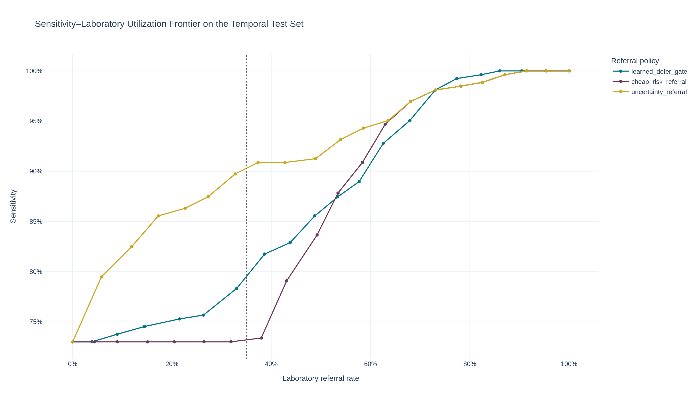
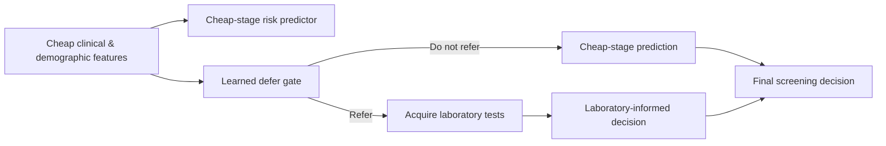
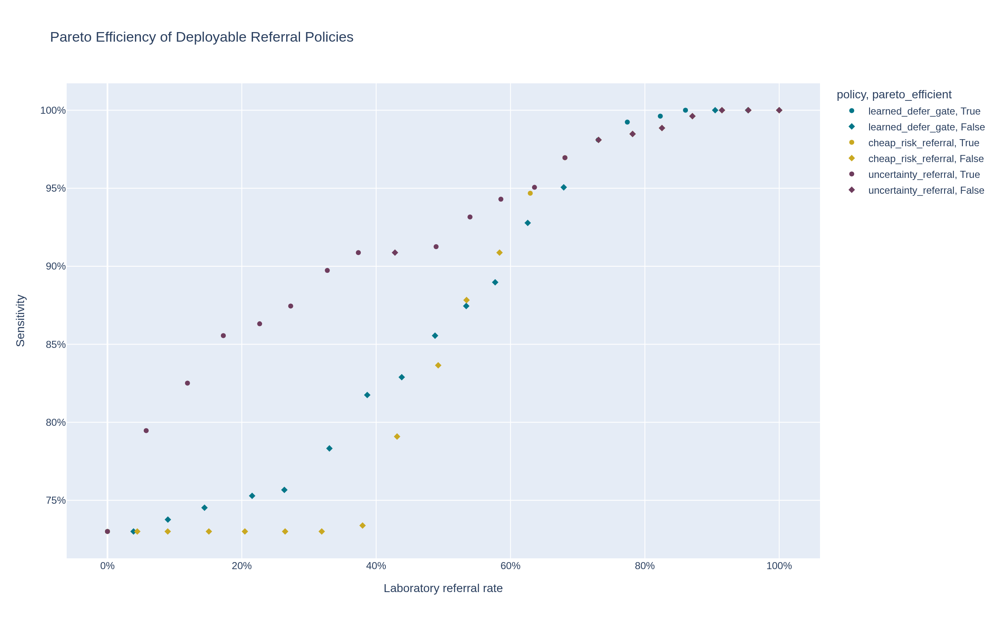
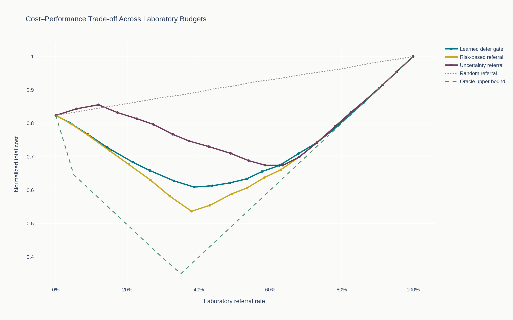
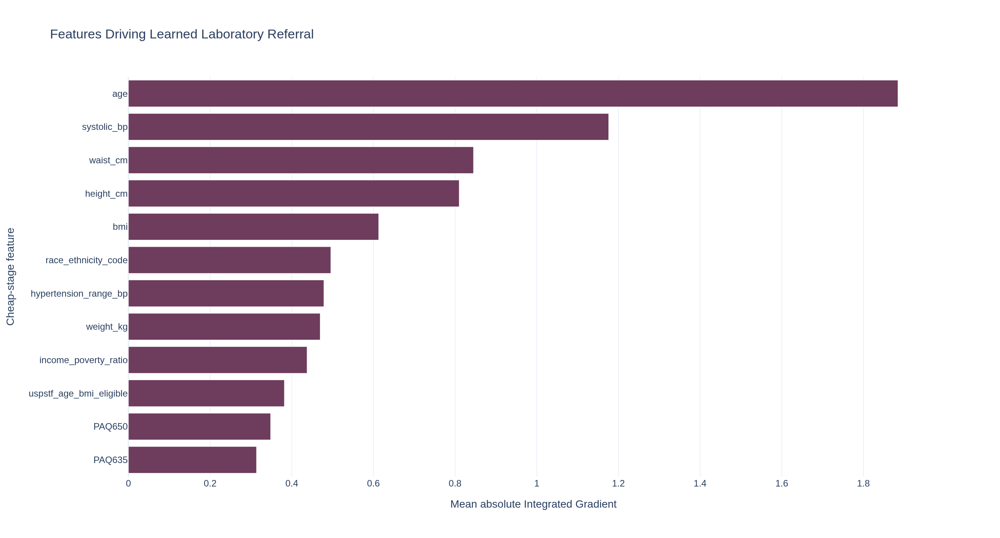
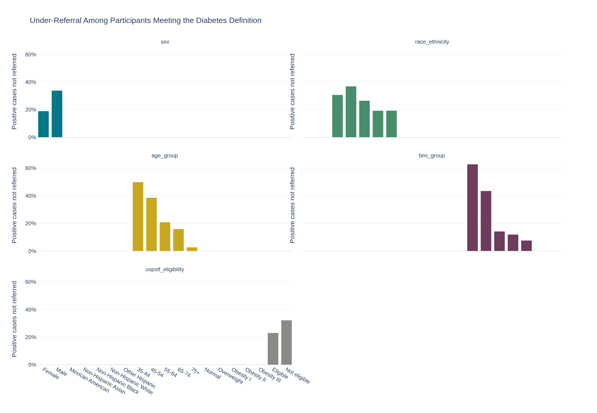

<a id="readme-top"></a>

<div align="center">

# Learning to Defer to Lab Tests

### Cost-Sensitive Selective Prediction for Diabetes Screening Cascades

<p align="center">
  A reproducible NHANES study of <strong>when inexpensive clinical information is enough</strong><br />
  and <strong>when laboratory testing should be acquired</strong>.
</p>

[](https://www.python.org/)
[](https://pytorch.org/)
[](https://jupyter.org/)
[](https://www.cdc.gov/nchs/nhanes/)

[](#reproducibility)
[](https://github.com/AdepojuJeremy/diabetes-defer-lab-tests/stargazers)
[](https://github.com/AdepojuJeremy/diabetes-defer-lab-tests/network/members)
[](https://github.com/AdepojuJeremy/diabetes-defer-lab-tests/commits/main)

<br />

<a href="RESULTS_INDEX.md"><strong>Explore all results »</strong></a>
&nbsp;&nbsp;•&nbsp;&nbsp;
<a href="RUN_ORDER.md">Reproduce the study</a>
&nbsp;&nbsp;•&nbsp;&nbsp;
<a href="REPRODUCIBILITY.md">Reproducibility notes</a>
&nbsp;&nbsp;•&nbsp;&nbsp;
<a href="DATA_AVAILABILITY.md">Data availability</a>

</div>

---

## Overview

Most diabetes-screening pipelines make a binary choice: either rely on inexpensive clinical information or order laboratory tests for everyone. This project studies a third option — **learn when to defer**.

The screening cascade combines three components:

1. **Cheap-stage predictor** — estimates diabetes risk from non-laboratory information.
2. **Laboratory-informed stage** — uses HbA1c and fasting plasma glucose when testing is acquired.
3. **Learned defer gate** — observes only cheap features and decides which patients should receive laboratory testing.

The central question is:

> **Can selective laboratory acquisition preserve much of the diagnostic value of universal testing while substantially reducing laboratory utilization?**

<p align="right">(<a href="#readme-top">back to top</a>)</p>

---

## Primary Result

<div align="center">
  <a href="results/main/figures/figure_1_sensitivity_lab_utilization_frontier.png">
    
  </a>
  <br />
  <sub><strong>Laboratory-utilization frontier:</strong> diagnostic sensitivity as the referral budget changes.</sub>
</div>

<br />

At the validation-selected operating point targeting approximately **35% laboratory utilization**, temporal transfer to the 2017–2018 test cohort produced a realized referral rate of **38.7%**. On the test set, the learned cascade achieved **81.7% sensitivity**, **93.9% specificity**, and **87.8% balanced accuracy** across **4,458 participants**.

> The 35% value is the requested validation budget; the realized temporal-test referral rate differs because the validation-selected gate threshold is transferred without retuning on the test cohort.

### Study at a glance

| Item | Design |
|---|---|
| **Dataset** | NHANES 2011–2018 |
| **Training** | 2011–2014 |
| **Validation** | 2015–2016 |
| **Temporal test** | 2017–2018 |
| **Primary endpoint** | HbA1c ≥ 6.5% **or** fasting plasma glucose ≥ 126 mg/dL |
| **Known diabetes** | Excluded from the primary screening cohort |
| **Target lab budget** | 35% |
| **Realized test referral** | 38.7% |
| **Test sensitivity** | 81.7% |
| **Test specificity** | 93.9% |
| **Test balanced accuracy** | 87.8% |
| **Primary normalized costs** | Lab = 1, FN = 10, FP = 2 |

<p align="right">(<a href="#readme-top">back to top</a>)</p>

---

<details>
  <summary><strong>Table of Contents</strong></summary>
  <ol>
    <li><a href="#overview">Overview</a></li>
    <li><a href="#primary-result">Primary Result</a></li>
    <li><a href="#research-design">Research Design</a></li>
    <li><a href="#modeling-framework">Modeling Framework</a></li>
    <li><a href="#results-gallery">Results Gallery</a></li>
    <li><a href="#repository-structure">Repository Structure</a></li>
    <li><a href="#getting-started">Getting Started</a></li>
    <li><a href="#notebook-workflow">Notebook Workflow</a></li>
    <li><a href="#data">Data</a></li>
    <li><a href="#reproducibility">Reproducibility</a></li>
    <li><a href="#interpretation-and-limitations">Interpretation and Limitations</a></li>
    <li><a href="#citation">Citation</a></li>
    <li><a href="#acknowledgments">Acknowledgments</a></li>
  </ol>
</details>

---

## Research Design

The study uses a strict **temporal evaluation design** rather than a random split:

```text
NHANES 2011–2014          NHANES 2015–2016          NHANES 2017–2018
      TRAIN        ───▶        VALIDATE       ───▶        TEST
  fit predictors              tune thresholds              locked evaluation
  fit defer gate              select budgets               temporal generalization
```

The primary screening cohort consists of adults without known diagnosed diabetes and with sufficient laboratory information to define the retrospective screening outcome.

**Operational screen-detected diabetes** is defined as:

- HbA1c ≥ 6.5%, **or**
- fasting plasma glucose ≥ 126 mg/dL.

The defer gate is deliberately restricted to **cheap features only**, preventing direct leakage of laboratory measurements into the referral decision.

<p align="right">(<a href="#readme-top">back to top</a>)</p>

---

## Modeling Framework



### What is optimized?

The framework jointly considers:

- predictive error;
- false-negative burden;
- false-positive burden;
- laboratory utilization;
- referral budget constraints;
- selective-prediction behavior under temporal shift.

The repository also evaluates risk-based referral, uncertainty referral, random referral, deterministic laboratory rules, and oracle-style upper bounds where appropriate.

<p align="right">(<a href="#readme-top">back to top</a>)</p>

---

## Results Gallery

<table>
  <tr>
    <td width="50%" align="center">
      <a href="results/main/figures/step11_pareto_efficient_policies.png">
        
      </a>
      <br /><strong>Pareto-efficient referral policies</strong>
    </td>
    <td width="50%" align="center">
      <a href="results/main/figures/step11_total_cost_by_lab_budget.png">
        
      </a>
      <br /><strong>Clinical cost across lab budgets</strong>
    </td>
  </tr>
  <tr>
    <td width="50%" align="center">
      <a href="results/main/figures/figure_2_defer_gate_interpretability.png">
        
      </a>
      <br /><strong>What drives laboratory referral?</strong>
    </td>
    <td width="50%" align="center">
      <a href="results/main/figures/figure_5_subgroup_under_referral.png">
        
      </a>
      <br /><strong>Subgroup under-referral analysis</strong>
    </td>
  </tr>
</table>

### Analysis coverage

The full research release includes:

- cohort characterization and EDA;
- cheap-stage and full-information baselines;
- neural defer-to-lab training;
- 0–100% laboratory-budget sweeps;
- matched-budget referral-policy comparisons;
- Pareto-efficiency and normalized clinical-cost analysis;
- subgroup fairness and calibration analyses;
- Integrated Gradients interpretability;
- value-of-information analyses;
- feature-group ablations;
- target-definition robustness;
- missingness stress tests;
- selected-budget retraining experiments.

**Main manuscript outputs:** [`results/main/`](results/main/)  
**Complete supplementary/appendix output:** [`results/supplementary/`](results/supplementary/)  
**Full figure/table catalogue:** [`RESULTS_INDEX.md`](RESULTS_INDEX.md)

<p align="right">(<a href="#readme-top">back to top</a>)</p>

---

## Repository Structure

```text
diabetes-defer-lab-tests/
│
├── notebooks/                 # Complete computational workflow
│   ├── 00_stage0_download_nhanes_aws.ipynb
│   ├── 01_project_setup_and_config.ipynb
│   ├── 02_load_merge_nhanes_data.ipynb
│   ├── 03_feature_tiers_and_splits.ipynb
│   ├── 04_eda_cohort_characterization.ipynb
│   ├── 05_baseline_models_and_referral_policies.ipynb
│   ├── 06_neural_defer_to_lab_model.ipynb
│   ├── 07_budget_sweeps_and_pareto_frontier.ipynb
│   ├── 08_fairness_calibration_and_equity.ipynb
│   ├── 09_interpretability_and_defer_gate.ipynb
│   ├── 10_ablations_and_robustness.ipynb
│   └── 11_final_synthesis_and_reproducibility.ipynb
│
├── results/
│   ├── main/
│   │   ├── figures/           # Manuscript-facing figures
│   │   └── tables/            # Manuscript-facing tables
│   └── supplementary/
│       ├── figures/           # Full appendix / supplementary figures
│       └── tables/            # Full appendix / supplementary tables
│
├── reports/                   # Final methods, results & limitations summaries
├── metadata/                  # Metrics, manifests, claims & release inventories
├── download_registry/         # NHANES acquisition manifests
├── data/README.md             # Data reconstruction guidance
├── DATA_AVAILABILITY.md
├── REPRODUCIBILITY.md
├── RESULTS_INDEX.md
├── RUN_ORDER.md
├── PROJECT_METADATA.md
├── requirements.txt
└── requirements-aws-freeze.txt
```

<p align="right">(<a href="#readme-top">back to top</a>)</p>

---

## Getting Started

### Prerequisites

- Python 3.x
- JupyterLab or Jupyter Notebook
- Sufficient memory for NHANES preprocessing and model fitting
- A CUDA-capable GPU is useful for the neural defer model and interpretability stages, but the repository preserves the completed research outputs for inspection without rerunning training.

### Clone the repository

```bash
git clone https://github.com/AdepojuJeremy/diabetes-defer-lab-tests.git
cd diabetes-defer-lab-tests
```

### Create an environment

```bash
python -m venv .venv
```

Activate it using the command appropriate for your platform, then install the core dependencies:

```bash
pip install -r requirements.txt
```

Launch Jupyter:

```bash
jupyter lab
```

Then follow [`RUN_ORDER.md`](RUN_ORDER.md).

<p align="right">(<a href="#readme-top">back to top</a>)</p>

---

## Notebook Workflow

| Stage | Notebook | Purpose |
|---:|---|---|
| 0 | `00_stage0_download_nhanes_aws.ipynb` | Acquire and verify NHANES source files |
| 1 | `01_project_setup_and_config.ipynb` | Project setup and configuration |
| 2 | `02_load_merge_nhanes_data.ipynb` | Load, harmonize and merge cycles |
| 3 | `03_feature_tiers_and_splits.ipynb` | Define feature tiers, target and temporal splits |
| 4 | `04_eda_cohort_characterization.ipynb` | Cohort characterization and EDA |
| 5 | `05_baseline_models_and_referral_policies.ipynb` | Cheap/full baselines and referral policies |
| 6 | `06_neural_defer_to_lab_model.ipynb` | Train the neural defer-to-lab model |
| 7 | `07_budget_sweeps_and_pareto_frontier.ipynb` | Budget sweeps, matched policies and Pareto analysis |
| 8 | `08_fairness_calibration_and_equity.ipynb` | Subgroup fairness, calibration and equity |
| 9 | `09_interpretability_and_defer_gate.ipynb` | Integrated Gradients and referral interpretation |
| 10 | `10_ablations_and_robustness.ipynb` | Ablations, stress tests and robustness |
| 11 | `11_final_synthesis_and_reproducibility.ipynb` | Final tables, figures, CIs and release metadata |

<p align="right">(<a href="#readme-top">back to top</a>)</p>

---

## Data

The project uses **NHANES 2011–2018** public-use data from the U.S. Centers for Disease Control and Prevention / National Center for Health Statistics.

Participant-level NHANES files and derived analytic datasets are **not redistributed** in this repository. The workflow reconstructs the required datasets from the public source files.

See:

- [`DATA_AVAILABILITY.md`](DATA_AVAILABILITY.md)
- [`data/README.md`](data/README.md)
- [`download_registry/`](download_registry/)

<p align="right">(<a href="#readme-top">back to top</a>)</p>

---

## Reproducibility

This repository is designed as a computational research release rather than a minimal code dump.

It preserves:

- all numbered computational notebooks;
- concise dependency requirements;
- the original AWS environment freeze;
- final figure and table inventories;
- final operating-point metrics;
- research-claims registry;
- artifact inventories and checksums from the completed run;
- acquisition/download registries;
- final Methods, Results and Limitations summaries;
- complete main and supplementary result collections.

The original computational run used **Ubuntu 22.04** on AWS with an **NVIDIA L4 GPU**. Public-release notebooks and manifests were subsequently sanitized to remove machine-specific infrastructure information.

See [`REPRODUCIBILITY.md`](REPRODUCIBILITY.md) for details.

<p align="right">(<a href="#readme-top">back to top</a>)</p>

---

## Interpretation and Limitations

This is **retrospective methodological research**, not a clinical diagnostic device.

Important interpretation points include:

- the outcome is an operational retrospective screening label based on one-time NHANES laboratory measurements;
- real-world diabetes diagnosis can require confirmatory testing;
- external and prospective validation would be required before clinical deployment;
- NHANES survey weights were not fully integrated into every modeling analysis, so unweighted quantities should not automatically be interpreted as population-representative estimates;
- fairness analyses are descriptive and examine referral allocation, positive-case referral coverage, under-referral, sensitivity, specificity and calibration rather than assuming equal referral rates are inherently fair.

The full limitations summary is available in [`reports/FINAL_LIMITATIONS.md`](reports/FINAL_LIMITATIONS.md).

<p align="right">(<a href="#readme-top">back to top</a>)</p>

---

## Citation

The associated manuscript is being prepared. Publication-specific citation metadata will be added when the author list and publication record are finalized.

For now, please reference the repository as:

> **Learning to Defer to Lab Tests: Cost-Sensitive Selective Prediction for Diabetes Screening Cascades.** Computational research release, 2026.

<p align="right">(<a href="#readme-top">back to top</a>)</p>

---

## Acknowledgments

- **NHANES / CDC / NCHS** for the publicly available health examination data used in this study.
- The maintainers of **Python**, **PyTorch**, **scikit-learn**, **pandas**, **Jupyter**, **Plotly**, and the broader scientific Python ecosystem.
- The open-source selective-prediction, calibration, interpretability and reproducibility communities whose tools make computational research releases possible.

<div align="center">

### Repository

<a href="https://github.com/AdepojuJeremy/diabetes-defer-lab-tests">
  github.com/AdepojuJeremy/diabetes-defer-lab-tests
</a>

<br /><br />

<strong>Built as a reproducible research release — not just a code archive.</strong>

<br /><br />

<a href="#readme-top">Back to top ↑</a>

</div>
